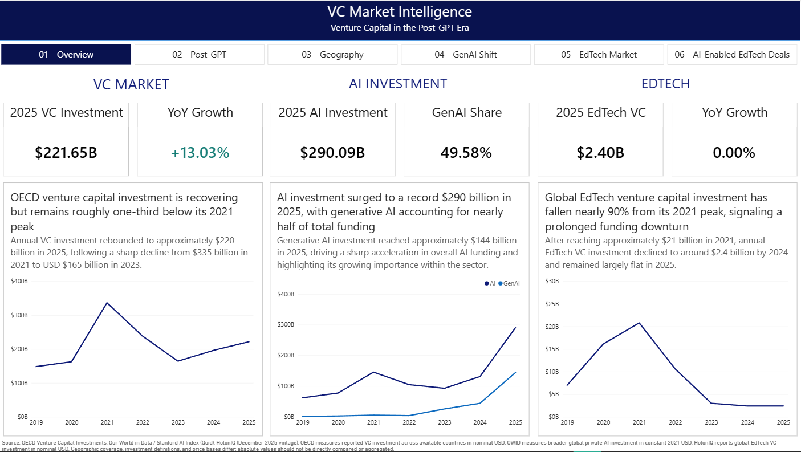
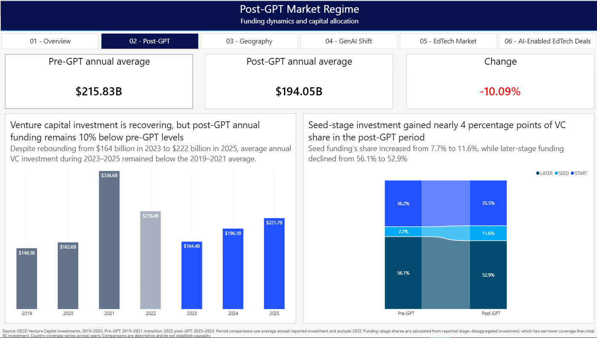
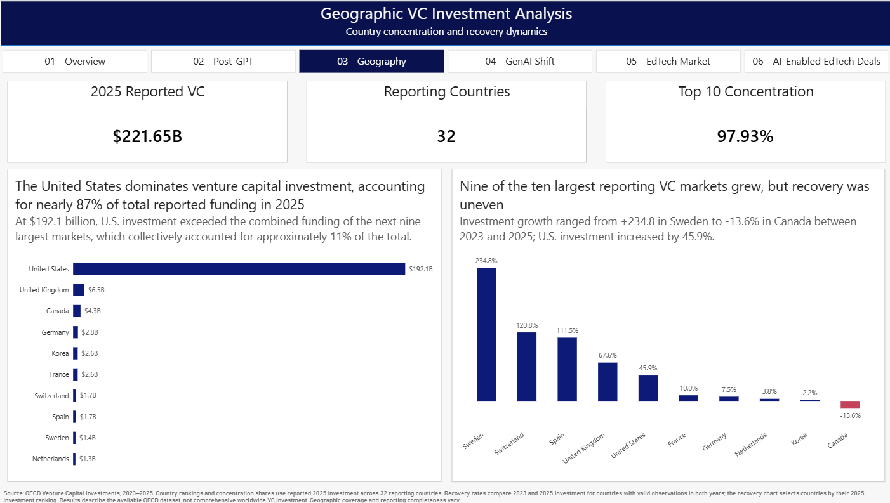
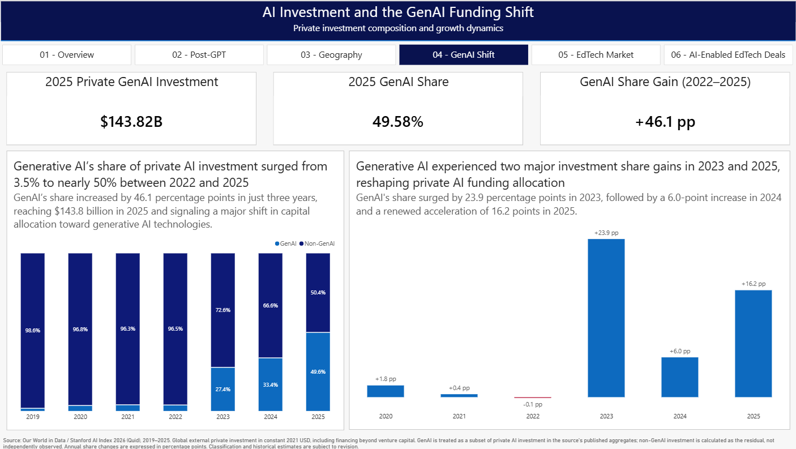
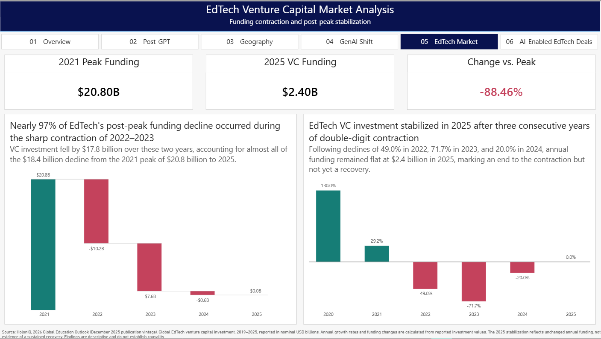
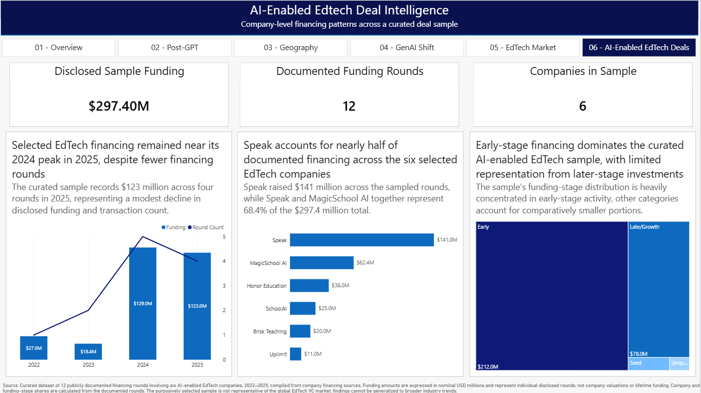

# VC Market Intelligence: Venture Capital in the Post-GPT Era

**An end-to-end Python and Power BI market-intelligence portfolio project | 2019–2025**

This project studies reported venture capital (VC) investment before and after the emergence of generative AI (GenAI), with dedicated analysis of geographic concentration, funding-stage composition, private AI and GenAI investment, and the EdTech sector. It combines source-aware Python pipelines, validation tests, a dimensional Power BI model, DAX measures, and a six-page interactive report.

**Status:** Six dashboard pages implemented; Python tests and data validators passed against the local project snapshot. Final publication and reproducibility documentation are being completed.

> **Interpretation:** “Post-GPT” is a time-period label, not a claim that ChatGPT caused the observed investment patterns. The report uses different data providers and investment definitions; their dollar figures must not be added together or treated as directly comparable market totals.

## Dashboard guide

| Page | Analysis |
| --- | --- |
| 01 · Overview | Executive view of OECD-reported VC, private AI investment, and global EdTech VC, with provider-specific definitions |
| 02 · Post-GPT | Pre/post period comparison, annual VC investment, and observed funding-stage allocation |
| 03 · Geography | 2025 concentration among OECD reporting countries and country-level growth between 2023 and 2025 |
| 04 · GenAI Shift | GenAI versus non-GenAI composition of private AI investment and annual change in GenAI share |
| 05 · EdTech Market | Global EdTech funding contraction, waterfall decomposition, and year-over-year change |
| 06 · AI-Enabled EdTech Deals | Disclosed financing activity, company concentration, and stage distribution in a selected deal sample |

The Power BI project file is [`powerbi/VCMarketIntelligence.pbip`](powerbi/VCMarketIntelligence.pbip). The repository contains the report and semantic-model definitions; local source files and configuration are needed to refresh the model on another machine.

## Dashboard Preview

The Power BI report contains six interactive analytical pages, covering venture capital investment, the post-GPT market regime, geographic concentration, generative AI, and EdTech financing.

### 01 — VC Market Overview

Executive overview of reported VC investment, private AI investment, and global EdTech venture funding from 2019 to 2025.



## Explore the Dashboard

<details>
<summary><b>02 — Post-GPT Market Regime</b></summary>

Annual investment trends and changes in funding-stage allocation between the pre-GPT and post-GPT periods.



</details>

<details>
<summary><b>03 — Geographic VC Investment Analysis</b></summary>

Country-level investment concentration and recovery dynamics across the leading reporting markets.



</details>

<details>
<summary><b>04 — AI Investment and the GenAI Funding Shift</b></summary>

Evolution of generative AI's share of private AI investment and annual changes in funding composition.



</details>

<details>
<summary><b>05 — EdTech VC Market Analysis</b></summary>

Global EdTech venture funding contraction from its 2021 peak and signs of stabilization in 2025.



</details>

<details>
<summary><b>06 — AI-Enabled EdTech Deal Intelligence</b></summary>

Financing activity, company concentration, and stage distribution across a curated sample of 12 rounds involving six companies.



</details>

*Data sources and measurement definitions differ by page. See the methodology documentation for coverage and limitations.*

## Data and scope

| Source | Use in project | Important qualification |
| --- | --- | --- |
| OECD Venture Capital Investments | Country-year VC totals and stage-level investment, 2019–2025 | Reported-country coverage varies by year; nominal USD |
| Our World in Data / Stanford AI Index (Quid) | Global AI and GenAI private-investment series, 2019–2025 | Constant 2021 USD; broader than VC-only financing |
| OECD.AI / Preqin | Selected published AI/GenAI VC benchmarks | Sparse observations, not a continuous annual panel |
| HolonIQ | Global EdTech VC series, 2019–2025 | Nominal USD; December 2025 publication vintage; provider-derived local data are not redistributed |
| Public company financing announcements | 12 selected rounds involving six AI-enabled EdTech companies, 2022–2025 | Purposive, non-representative sample; round amounts are not valuations or lifetime fundraising |

The annual dashboard convention is **pre-GPT: 2019–2021**, **transition: 2022**, and **post-GPT: 2023–2025**. The broader event-time framework treats Q4 2022 as the transition quarter; the annual dashboard excludes the entire year 2022 from direct pre/post averages because it cannot separate quarters in the OECD annual series.

See the detailed source, transformation, and classification notes in [`docs/data_sources.md`](docs/data_sources.md), [`docs/project_scope.md`](docs/project_scope.md), [`docs/owid_ai_methodology.md`](docs/owid_ai_methodology.md), [`docs/edtech_market_methodology.md`](docs/edtech_market_methodology.md), and [`docs/edtech_rounds_methodology.md`](docs/edtech_rounds_methodology.md).

## Technical architecture

- **Extract and transform:** Python and pandas scripts in `src/extract/` and `src/transform/`.
- **Validate:** source-specific validators in `src/validation/`, plus offline unit tests in `tests/`.
- **Model:** eleven generated CSV marts (five dimensions, six facts), loaded into Power BI through Power Query.
- **Analyze:** a Power BI semantic model with source-separated facts, relationships, and DAX measures; six report pages under `powerbi/`.
- **Document:** research scope, source governance, and data-model grain in `docs/`.

The OECD total fact and the OECD stage fact are kept separate to avoid counting `_T` totals alongside their stage components. The curated EdTech deals are **not** joined to the HolonIQ global market total as if they represented the complete sector.

## Installation and validation

With Python installed, from the repository root:

```powershell
python -m pip install -r requirements.txt
python -m unittest discover -s tests -p "test_*.py" -v
```

To validate locally available processed datasets:

```powershell
python -m src.validation.validate_oecd_vc
python -m src.validation.validate_oecd_ai_benchmarks
python -m src.validation.validate_owid_ai
python -m src.validation.validate_edtech_market
python -m src.validation.validate_edtech_rounds
python -m src.validation.validate_powerbi_marts
```

To rebuild the eleven Power BI marts **after all five required processed source files exist locally**:

```powershell
python -m src.transform.build_powerbi_marts
```

Generated marts appear in `data/mart/powerbi/` and are intentionally ignored by Git. The repository does **not** contain all source-provider data necessary for a fresh end-to-end rebuild. Consult [`docs/powerbi_data_model.md`](docs/powerbi_data_model.md) and the source-specific documentation for prerequisites; no missing data should be replaced by fabricated observations.

### Opening the Power BI report

1. Open [`powerbi/VCMarketIntelligence.pbip`](powerbi/VCMarketIntelligence.pbip) in a compatible Power BI Desktop version.
2. To refresh the report, generate the eleven CSV marts locally, then navigate to **Transform data → Manage Parameters** and set `pMartFolder` to the absolute path of the `data/mart/powerbi/` directory (including the trailing path separator). All eleven Power Query imports use this shared parameter.
3. Verify imported tables and refresh behavior before using updated figures. A definition-only checkout is not guaranteed to contain the original imported data cache.

## Repository map

| Path | Contents |
| --- | --- |
| `src/` | Extraction, transformation, validation, and source manifests |
| `tests/` | Offline pipeline tests |
| `data/` | Source and output locations; excluded restricted inputs documented in `data/README.md` |
| `powerbi/` | Power BI project, report, semantic model, and theme resources |
| `docs/` | Scope, source governance, taxonomy, and data-model documentation |
| `notebooks/` | Exploratory OECD VC analysis |

## Limitations and responsible reuse

1. **Comparability:** OECD VC, OWID private AI investment, OECD.AI benchmarks, and HolonIQ EdTech VC differ in scope, coverage, vintages, and/or price basis. Do not sum them or infer missing residuals between providers.
2. **Coverage:** OECD observations describe the countries and years reported in the extract; they are not a complete global VC census. Stage-disaggregated observations have narrower coverage than totals.
3. **Period classification:** Annual pre/post comparisons exclude 2022 and are descriptive rather than causal. The historical funding peak in 2021 materially affects the pre-period average.
4. **Deal sample:** The six selected companies and twelve publicly documented rounds do not support claims about market-wide EdTech deal counts, investor returns, or AI's share of the EdTech VC market.
5. **Data rights:** HolonIQ-derived values and certain other provider-derived datasets are intentionally kept out of the public Git repository. Do not redistribute restricted data or publish screenshots that materially reproduce provider data without first confirming permitted use. The MIT license covering original repository code does not grant rights to third-party data.

## License

Original project code and documentation are provided under [`LICENSE`](LICENSE), subject to applicable third-party data rights and source terms.